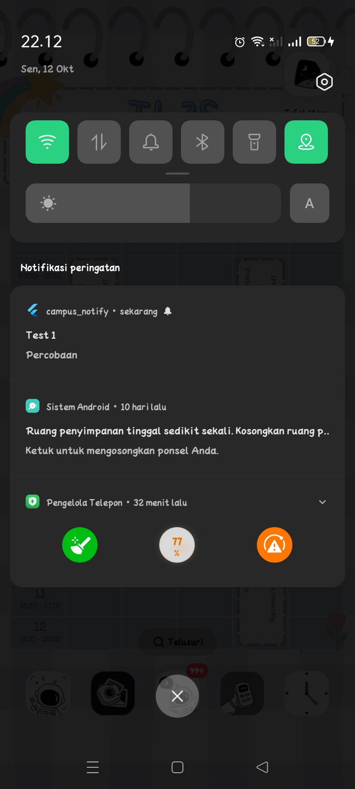
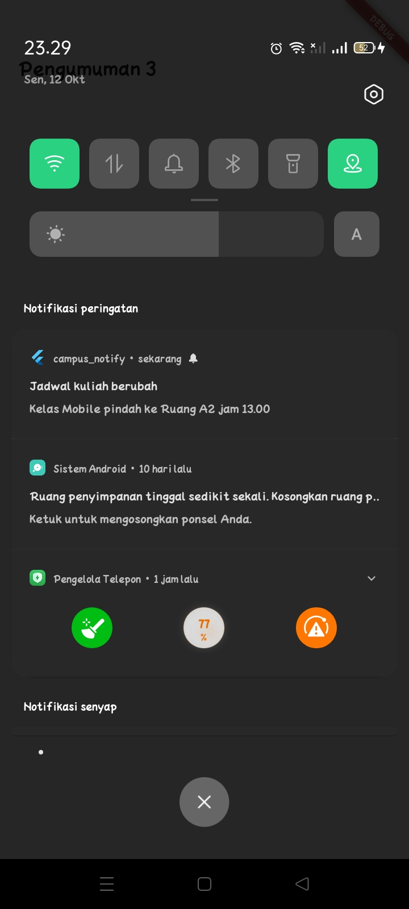
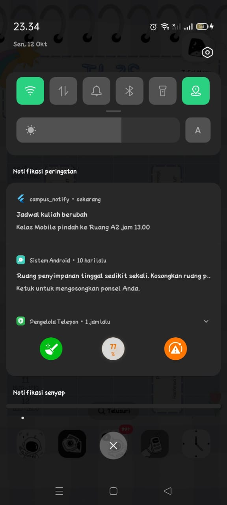
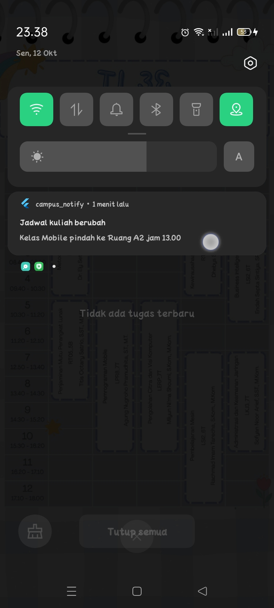

# WEEK 6 -  Authentication, Security & FCM
## Tujuan
Aplikasi pengumuman kampus dengan login, penyimpanan token aman, dan push notification FCM.

## Fitur utama
- Login mock dengan guard route (GoRouter + Riverpod)
- Token di flutter_secure_storage, Dio refresh otomatis saat 401
- FCM: permission, token + onTokenRefresh, topik pengumuman-kampus
- Klik notifikasi membuka /pengumuman/:id

## Stack
Flutter, Riverpod, GoRouter, Dio, flutter_secure_storage, Firebase Messaging, flutter_local_notifications

## Cara menjalankan
flutter pub get
(letakkan google-services.json di android/app/)
flutter run

## Praktikum 1: Login + secure storage + token refresh
### Hasil
<table>
  <tr>
    <td></td>
    <td></td>
    <td></td>
  </tr>
</table>

### Test

## Praktikum 2: FCM, permission, dan token lifecycle
### Hasil

Saat notifikasi di klik, maka akan mengarah ke aplikasi.

### Test

## Praktikum 3: Payload, tiga app state, klik dan topik

### Matriks pengujian wajib

| State      | Diharapkan                               | Hasil | Bukti |
|------------|------------------------------------------|-------|-------|
| Foreground | Banner lokal muncul, klik ke /pengumuman/3 | Lolos   ||
| Background | Banner sistem muncul, klik ke rute benar    | Lolos   ||
| Terminated | Terbuka ke rute benar via getInitialMessage | Lolos   ||

### Topic messaging
<table>
  <tr>
    <td></td>
    <td></td>
    <td></td>
  </tr>
</table>

## AI Challenge

## Refactoring, testing, dan error umum
### Test

<table>
  <tr>
    <td></td>
    <td></td>
  </tr>
</table>

## Tugas, refleksi, dan referensi
### Mini Project
| State      | Diharapkan                               | Hasil | Bukti |
|------------|------------------------------------------|-------|-------|
| Foreground | Banner lokal muncul, klik ke /pengumuman/2 | Lolos   ||
| Background | Banner sistem muncul, klik ke rute benar    | Lolos   ||
| Terminated | Terbuka ke rute benar via getInitialMessage | Lolos   ||

### Hasil
<table>
  <tr>
    <td></td>
  </tr>
</table>

### Test
<table>
  <tr>
    <td></td>
    <td></td>
  </tr>
</table>

### Refleksi

1. Mengapa refresh token tidak boleh disimpan di SharedPreferences?
SharedPreferences menyimpan data tanpa enkripsi, jadi bisa dibaca di perangkat yang di-root atau lewat backup. Refresh token berumur panjang, jadi kalau bocor, penyerang bisa terus meminta access token baru dan menyamar sebagai pengguna tanpa tahu kata sandinya. Karena itu token disimpan di flutter_secure_storage (Keystore/Keychain).

2. Apa yang rusak bila onTokenRefresh diabaikan?
Backend terus menyimpan token FCM lama yang sudah basi, sehingga notifikasi tidak sampai ke perangkat tanpa ada error yang terlihat. Mahasiswa melewatkan pengumuman penting seperti jadwal kuliah berubah.

3. Kapan memakai topik dan token perangkat?
Topik untuk broadcast ke banyak orang, misalnya “Kelas Mobile pindah ke Ruang A2 jam 13.00” ke semua mahasiswa. Token perangkat untuk pesan personal, misalnya “Nilai UTS Anda sudah keluar” atau “Tagihan UKT jatuh tempo besok”. Topik tidak cocok untuk pesan personal karena siapa pun bisa berlangganan.